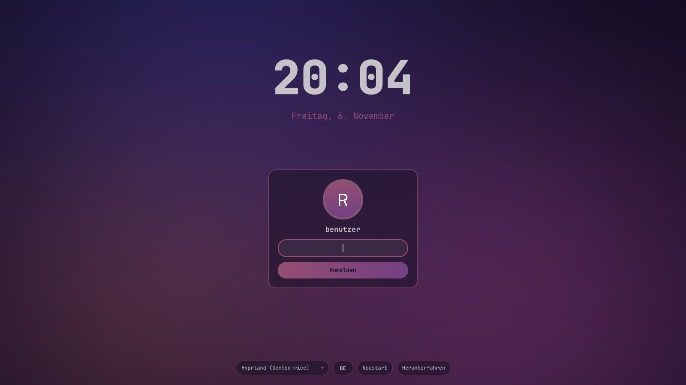
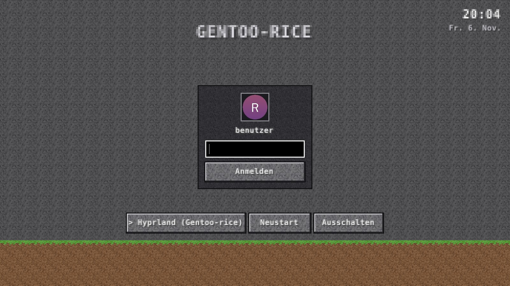

# Gentoo-rice

🇬🇧 [English](README.md) · 🇩🇪 **Deutsch**

Wallpaper-basiertes **Anime-/Lofi**-Hyprland-Rice für **Gentoo (OpenRC)** – alle Farben kommen aus dem aktuellen Wallpaper.

| Desktop | Wallpaper-Picker | Terminal-Spielzeug |
|---|---|---|
|  |  |  |

<!-- Screenshot-Platzhalter: desktop.png, picker.png, toys.png in screenshots/ ablegen -->

## Features

- **Dynamische Farben** mit pywal16: Hyprland-Borders, Waybar, kitty, rofi, mako, cava, btop, fastfetch und hyprlock werden bei jedem Wallpaper-Wechsel neu eingefärbt
- **Theme-Wechsler** (`Super + Shift + T`): lofi (Farben aus dem Wallpaper), fsociety, clean, Catppuccin Mocha/Latte, Nord, Gruvbox, Tokyo Night, Sakura – Farben, Optik, Wallpaper und GTK-Farben mit einem Klick
- **Hyprland** – halbtransparente Fenster, starker Blur, 10px Rundung, dünner Akzent-Border (Verlauf), 10px Gaps, Popin-/Slide-Animationen
- **Waybar** als drei schwebende Inseln:
  links Media-Player (prev/play/next + Titel über playerctl) · Mitte Workspace-Pills (aktiver breiter, in Akzentfarbe) · rechts CPU, RAM, Lautstärke, WLAN, Bluetooth, Akku, Uhrzeit, Power
- **Wallpaper:** Bilder über swww/awww mit Übergangsanimation, Videos über mpvpaper
- **Wallpaper-Picker** (`Super + W`): horizontale Leiste unten mit gecachten ffmpeg-Vorschaubildern, Videos mit **VIDEO**-Badge
- **Wallpaper Engine** Live-Wallpaper aus Steam (optional, `./install.sh --we`)
- **Terminal-Spielzeug** als schwebende Fenster: cava, btop, cmatrix, tty-clock, fastfetch (Gentoo-Logo), Songtext-Overlay (sptlrx)
- **hyprlock** in denselben dynamischen Farben, zeigt den aktuellen Song
- **Login-Screen** (optional, `--login`): SDDM im Rice-Look oder im Klötzchen-Stil, hyprlock passend dazu
- **Claude Code** standardmäßig über den offiziellen nativen Installer (`Super + K` öffnet es im Terminal)
- **Firefox**, rofi-Launcher, mako-Benachrichtigungen, Papirus-Icons
- **Sauberer Mauszeiger:** Bibata über hyprcursor (scharf bei jeder Skalierung), verschwindet beim Tippen und nach 5 s Inaktivität, lineare Mausbeschleunigung, Zwei-Finger-Rechtsklick, sanfteres Touchpad-Scrollen
- **.exe-Spiele:** Proton-GE für Steam, ProtonUp-Qt, Bottles (`.exe` per Doppelklick)
- **Gaming:** Mesa/RADV für Radeon 780M, Vulkan-Tools, Flatpak + Flathub, Steam (Flatpak), gamemode, MangoHud (nativ + Flatpak-Layer); Steam und Spiele ohne Blur/Transparenz, Spiele im Vollbild mit Tearing für niedrige Latenz

## Installation

```sh
git clone https://github.com/Real3rr0r303YT/Gentoo-rice && cd Gentoo-rice && ./install.sh
```

```sh
./install.sh --dry-run   # nur anzeigen, was installiert/geändert würde (kein sudo, keine Änderungen)
./install.sh --no-claude # ohne Claude Code
./install.sh --no-av     # ohne Virenschutz
./install.sh --no-apps   # ohne Spotify/Spicetify, Minecraft, Sober, OBS
./install.sh --no-grub   # GRUB nicht anfassen
./install.sh --login     # mit grafischem Login-Screen (SDDM)
```

Als normaler Benutzer starten – `sudo`/`doas` wird nur für Systemschritte genutzt.
Jeder Lauf wird nach `~/.cache/gentoo-rice/install.log` geloggt. Vor dem Bauen macht emerge einen Probelauf (`--pretend`); nötige USE-/Keyword-/Lizenz-Änderungen werden automatisch übernommen (autounmask + `etc-update --automode -5`). Schlägt der Sammel-emerge fehl, werden die Pakete einzeln nachinstalliert und alle Fehlschläge am Ende aufgelistet.
Das Skript ist mehrfach ausführbar; nicht verfügbare Pakete werden gemeldet und übersprungen.
Vorhandene Configs werden nach `~/.config-backup/gentoo-rice/<Datum>/` gesichert.

Danach neu starten und auf **TTY1** einloggen → Hyprland startet automatisch.

### Wallpaper

Bilder (`jpg png webp gif`) oder Videos (`mp4 mkv webm mov`) nach **`~/Pictures/wallpapers`** legen.
Mitgeliefert werden nur drei selbst generierte Verlaufs-Platzhalter – keine fremden Bilder.

```sh
~/.local/share/gentoo-rice/scripts/wallpaper.sh set <datei>   # setzen + Farben neu erzeugen
~/.local/share/gentoo-rice/scripts/wallpaper.sh random
~/.local/share/gentoo-rice/scripts/gen-wallpaper.sh 2880x1800 # neuer Verlaufs-Platzhalter
```

### Steam

`Super + G` öffnet Steam. Startoptionen für Spiele: `gamemoderun mangohud %command%`

### Aktualisieren

```sh
./scripts/update.sh            # Rice: git pull, Links prüfen, Farben, Hyprland/Waybar neu laden
                               # installiert Hyprland, hyprlock, hypridle + Portal, falls etwas fehlt
./scripts/update.sh --system   # zusätzlich Hyprland auf neueste Version, Gentoo (@world) + Flatpaks
```

### GRUB-Bootmenü

```sh
./scripts/grub-setup.sh               # Klötzchen-Theme, Menü 5 s sichtbar, Windows-Eintrag über os-prober
./scripts/grub-setup.sh --theme blue  # blaues Theme (passend zum Login-Screen)
./scripts/grub-setup.sh --no-theme    # ohne Theme
./scripts/grub-setup.sh --timeout 10  # andere Wartezeit
./scripts/grub-setup.sh --restore     # Original von /etc/default/grub zurück
```

Setzt `GRUB_TIMEOUT`, `GRUB_TIMEOUT_STYLE=menu` und `GRUB_DISABLE_OS_PROBER=false`, erzeugt das Menü auf Englisch mit kurzen Namen (`Gentoo` – bleibt nach Kernel-Updates über `/etc/kernel/postinst.d/99-gentoo-rice-grub`), sichert vorher `/etc/default/grub` und schreibt `/boot/grub/grub.cfg` neu. Standard ist der Klötzchen-Look (Erde, Stein-Knöpfe, Pixel-Titel, Unifont – eigene Texturen, keine Original-Assets) in `/boot/grub/themes/gentoo-rice-blocks`; `--theme blue` nimmt das blaue Theme (unscharfes Wallpaper, JetBrains Mono über `grub-mkfont`). `./install.sh` macht das automatisch, wenn GRUB installiert ist.

**Handy-Ecosystem (KDE Connect):** startet mit Hyprland. Auf dem Handy die App *KDE Connect* installieren, gleiches WLAN, im Rice-Menü *Handy verbinden* → koppeln. Dann: Dateien senden, gemeinsame Zwischenablage, Handy-Benachrichtigungen am PC, Medien steuern.

### Virenschutz (ClamAV)

```bash
./scripts/antivirus.sh setup         # ClamAV + Signaturen, Dienste freshclam/clamd (macht ./install.sh automatisch, --no-av)
./scripts/antivirus.sh update        # installieren bzw. ClamAV + Signaturen aktualisieren (Rice-Menü: „Virenschutz installieren/aktualisieren“)
./scripts/antivirus.sh scan ~/Downloads   # Ordner prüfen
```

- **Echtzeit-Wächter** (startet mit Hyprland): neue Dateien in `~/Downloads` sowie Mods/Programme in den Minecraft-, CurseForge- und Sober-Ordnern werden sofort geprüft; Funde landen gesperrt in `~/.local/share/gentoo-rice/quarantine` mit Warnung
- Minecraft, CurseForge und Sober laufen **abgeschottet** (Flatpak ohne Zugriff auf den Home-Ordner) – ein Schad-Mod kommt nicht an deine Dateien
- Rice-Menü (`Super + D`): *Virenscan (Home)*, *Quarantäne öffnen*
- **Ehrlich:** ClamAV erkennt nur bekannte Schadsoftware. Gecrackte Mods/Clients sind der häufigste Weg für Stealer und Trojaner – ein sauberer Scan ist keine Garantie. Gegen Ransomware hilft am meisten ein Backup auf einem getrennten Datenträger.

### Apps: Spotify + Spicetify, Gaming, OpSec (Proton), OBS Studio

```bash
./scripts/apps.sh             # Spotify + Spicetify, Minecraft Java, CurseForge, Sober (Roblox), Roblox Studio (Vinegar), KDE Connect, Mullvad VPN (GURU), Proton Pass/Mail/Calendar/Authenticator, Tor Browser, Signal, OBS Studio – alles Flatpak
./scripts/mullvad.sh status    # Mullvad prüfen; ./scripts/mullvad.sh setup richtet den OpenRC-Dienst ein
./scripts/apps.sh update      # alle Apps aktualisieren (auch im Rice-Menü: „Apps aktualisieren“)
./scripts/apps.sh spicetify   # Spicetify nach einem Spotify-Update neu anwenden (macht update.sh --system automatisch)
```

Spicetify nutzt das Theme `GentooRice` mit den aktuellen Rice-Farben (wird bei jedem Wallpaper-/Theme-Wechsel angepasst). `Super + S` öffnet Spotify; Minecraft, Roblox (Sober) und OBS stehen im Rice-Menü (`Super + D`) und im Launcher.

### Deinstallation

```sh
./uninstall.sh
```

Entfernt alle Symlinks (auch alte wofi-/mako-/Dock-Links, fastfetch, Firefox-Profildateien), den Autostart, den fastfetch-Eintrag in `~/.bashrc`, die Firefox-Policies, die Platzhalter-Wallpaper und den Thumbnail-Cache und spielt das Backup zurück.

## Wallpaper Engine

Live-Wallpaper aus **Wallpaper Engine** (Steam) über [linux-wallpaperengine](https://github.com/Almamu/linux-wallpaperengine) von Almamu.

**Voraussetzungen**

- Wallpaper Engine **in Steam gekauft und installiert** (App-ID 431960) – Assets und Workshop-Wallpaper kommen von dort
- Steam als Flatpak (`~/.var/app/com.valvesoftware.Steam/.local/share/Steam`) oder nativ (`~/.local/share/Steam`); weitere Bibliotheken aus `libraryfolders.vdf` werden automatisch erkannt

**Installation**

```sh
./install.sh --we                 # Rice + Wallpaper Engine
./scripts/wallpaperengine.sh      # nur Wallpaper Engine (erneut ausführen = git pull + neu bauen)
```

Installiert die Build-Abhängigkeiten per emerge, klont das Repo mit Submodulen nach `~/.local/src/linux-wallpaperengine`, baut es mit cmake und installiert es nach `~/.local/bin`.

**Nutzung**

- Wallpaper im Steam-Workshop abonnieren → `Super + W` zeigt sie mit **WE**-Badge und Titel aus `project.json` (Typen `scene` und `video`; `web` als experimentell markiert)
- Direkt: `~/.local/share/gentoo-rice/scripts/we-set.sh <Workshop-ID|Ordner>` · beenden: `we-set.sh stop`
- Die Rice-Farben werden aus `preview.jpg/gif` des Wallpapers erzeugt
- Das zuletzt gewählte Wallpaper wird beim Hyprland-Start wiederhergestellt
- Einstellungen in `~/.config/gentoo-rice/wallpaperengine.conf`: FPS (Standard 30), Ton (Standard `--silent`), Automute, Skalierung, **Pause bei Vollbild-Fenstern** (Standard an, über Hyprland-Socket-Events), zusätzliche Argumente
- Startet linux-wallpaperengine nicht, wird das Vorschaubild über swww gezeigt und ein Fehler per Benachrichtigung gemeldet (Log: `~/.cache/rice/linux-wallpaperengine.log`)

**Bekannte Einschränkungen**

- Nicht jede Szene wird korrekt dargestellt – linux-wallpaperengine unterstützt nicht alle Effekte von Wallpaper Engine
- `web`-Wallpaper sind experimentell, `application`-Wallpaper werden nicht unterstützt
- Benutzer-Eigenschaften aus der Wallpaper-Engine-Oberfläche werden nicht automatisch übernommen
- Pausieren hält den Prozess an (SIGSTOP) – das letzte Bild bleibt sichtbar
- Es werden keine Wallpaper oder Workshop-Inhalte mitgeliefert

## Login-Screen (optional)

Grafischer Login mit **SDDM** im Wayland-Modus (Greeter läuft in Weston, deutsche Tastatur) statt Login auf TTY1:

```sh
./install.sh --login              # Rice + Login-Screen (Theme gentoo-rice)
./install.sh --login=minecraft    # Klötzchen-Look
./scripts/login-screen.sh --theme gentoo-rice   # nur Login-Screen
```

| `gentoo-rice` | `gentoo-rice-blocks` |
|---|---|
|  |  |

| Theme | Aussehen |
|---|---|
| `gentoo-rice` | aktuelles Wallpaper unscharf, Farben aus der Palette (pywal16 bzw. aktives Theme), große Uhr + Datum, runder Avatar, Glas-Passwortfeld, Sitzungsauswahl (Hyprland vorausgewählt), Neustart/Herunterfahren |
| `gentoo-rice-blocks` (`--login=minecraft`) | Pixel-Schrift, Fels-/Erde-Texturen, Klötzchen-Buttons – alle Grafiken selbst erzeugt (`tools/gen-pixel-textures.py`), keine fremden Texturen, Logos oder Schriften |

- **Avatar:** Bild als `~/.face` speichern (sonst Platzhalter mit Initiale), dann `scripts/sddm-sync.sh`
- Wallpaper, Farben und Avatar werden bei jedem Wallpaper-/Theme-Wechsel automatisch nach `/var/lib/gentoo-rice/sddm/` übertragen; **hyprlock** nutzt denselben Stil und Avatar
- Sitzung „Hyprland (Gentoo-rice)“ startet Hyprland mit dbus-Sitzungsbus (OpenRC)
- Der TTY1-Autostart wird entfernt, damit Hyprland nicht doppelt startet
- OpenRC: `gui-libs/display-manager-init`, `DISPLAYMANAGER="sddm"` in `/etc/conf.d/display-manager`, `display-manager` im Runlevel `default`
- Ohne Weston fällt SDDM auf X11 zurück
- Jede geänderte Systemdatei wird gesichert (`/var/lib/gentoo-rice/backup/`)

**Rückgängig:** `./scripts/login-screen-uninstall.sh` – nimmt `display-manager` aus dem Runlevel, spielt alle Dateien zurück und stellt den TTY1-Autostart wieder her.

### Notausgang

Startet der Login-Screen nicht (schwarzer Bildschirm, Absturz):

1. `Strg + Alt + F2` drücken → auf der Textkonsole einloggen
2. `sudo rc-update del display-manager default`
3. `sudo reboot` → Login wieder auf TTY1
4. Danach in Ruhe: `./scripts/login-screen-uninstall.sh`

Tipp: Login-Theme ohne Neustart ansehen: `pip install PySide6-Essentials` und `QT_QPA_PLATFORM=offscreen python3 tools/sddm-preview.py sddm/gentoo-rice vorschau.png`

## Themes

`Super + Shift + T` (oder das Paletten-Icon in der Waybar) öffnet eine Leiste mit Farbvorschau. Ein Theme setzt:

- Farben für Hyprland-Rahmen, Waybar, kitty, rofi, mako, cava, btop, fastfetch, hyprlock und **GTK-3/4-Apps** (`~/.config/gtk-*/gtk.css`)
- Optik: Gaps, Rundung, Transparenz, Blur
- Mauszeiger: Bibata Ice (weiß), Classic (schwarz) oder Amber, passend zum Theme
- Hell/Dunkel für GTK/libadwaita
- ein erzeugtes Verlaufs-Wallpaper in den Theme-Farben

| Theme | Stil |
|---|---|
| `lofi` | Farben aus dem aktuellen Wallpaper (pywal16), Standard |
| `fsociety` | Schwarz/Rot, kantig |
| `clean` | minimalistisch dunkel, blauer Akzent |
| `catppuccin-mocha` / `catppuccin-latte` | Pastell dunkel / hell |
| `nord` | kühles Blau-Grau |
| `gruvbox` | warm, retro |
| `tokyo-night` | Neon blau/lila |
| `sakura` | Kirschblüten-Rosa |

Bei einem festen Theme behalten Wallpaper aus `Super + W` die Theme-Farben; mit `lofi` kommen die Farben wieder aus dem Wallpaper.

```sh
~/.local/share/gentoo-rice/scripts/theme.sh list
~/.local/share/gentoo-rice/scripts/theme.sh set nord
```

Eigenes Theme: `themes/nord/` nach `themes/<name>/` kopieren und `theme.conf` anpassen (Palette, Optik, `WALLPAPER=gradient|keep`).

## Proton & .exe-Spiele

- **Steam-Spiele:** Steam (Flatpak) bringt Proton mit. Einmal aktivieren: *Steam → Einstellungen → Kompatibilität → „Steam Play für alle anderen Titel aktivieren“*. **GE-Proton** (Flatpak-Erweiterung) ist dort oder pro Spiel (*Eigenschaften → Kompatibilität*) wählbar.
- **ProtonUp-Qt** installiert/aktualisiert weitere Proton-Versionen (GE-Proton, Wine-GE).
- **Einzelne .exe-Spiele/Installer:** `.exe` doppelklicken → öffnet sich mit **Bottles** (Flasche vom Typ „Gaming“ empfohlen). Alternativ in Steam: *Ein Nicht-Steam-Spiel hinzufügen* und Proton wählen.
- Bottles darf auf deinen Home-Ordner und `/run/media` (externe Laufwerke) zugreifen.

## Claude Code

`install.sh` installiert [Claude Code](https://claude.ai/code) über den offiziellen nativen Installer (`curl -fsSL https://claude.ai/install.sh | bash`), ergänzt `~/.local/bin` im `PATH` (`~/.bashrc`) und prüft `claude --version`. Danach aktualisiert sich Claude Code selbst.

```sh
claude                              # im aktuellen Ordner starten (beim ersten Start Login im Browser)
./scripts/install-claude-code.sh    # nur Claude Code installieren/prüfen
```

`Super + K` öffnet Claude Code in einem neuen Terminal. Das komplette Entwickler-Setup (`--dev`) bringt zusätzlich VS Code mit der Claude-Code-Extension.

## Firefox

- Installiert `www-client/firefox-bin` (kein Kompilieren) und setzt ihn als Standardbrowser (`xdg-mime`/`xdg-settings` für http, https, HTML)
- `firefox/user.js` + `firefox/userChrome.css` werden ins Standardprofil verlinkt (Profil wird bei Bedarf headless angelegt)
- `firefox/policies.json` → `/etc/firefox/policies/` und `/opt/firefox/distribution/`: Telemetrie aus, Tracking-Schutz streng, uBlock Origin wird automatisch installiert
- `Super + B` öffnet Firefox (immer deckend)

## Dev-Setup

Optionales Entwickler-Setup – zusammen mit dem Rice oder einzeln:

```sh
./install.sh --dev          # Rice + Dev-Setup
./scripts/dev-setup.sh      # nur Dev-Setup
```

| Bereich | Inhalt |
|---|---|
| Editor | VS Code (`app-editors/vscode`, Lizenz wird freigegeben), Neovim |
| KI | Claude Code über den offiziellen nativen Installer, PATH in `~/.bashrc` |
| Extensions | Claude Code, Python, Pylance, GitLens, Error Lens, GitHub Theme |
| VS-Code-Look | JetBrains Mono + Ligaturen, Rice-Farben, Custom-Titelleiste, Smooth Scrolling, Wayland (`~/.config/code-flags.conf`) |
| Python | `dev-lang/python`, pip, pipx (`pipx ensurepath`), venv |
| Tools | git, GitHub CLI, Node.js + npm, gcc, clang, cmake, make, ripgrep, fd, jq, htop, btop, curl, wget |
| Git | fragt Name/E-Mail ab, falls nicht gesetzt |

Mehrfach ausführbar; nicht verfügbare Pakete werden gemeldet und übersprungen.
Eine vorhandene `settings.json` wird vor dem Ersetzen gesichert (`settings.json.bak-<Datum>`).
Am Ende erscheint eine Übersicht der installierten Versionen.

## Keybinds

| Taste | Aktion |
|---|---|
| `Super + Enter` | Terminal (kitty) |
| `Super + Leertaste` | Launcher (rofi) |
| `Super + W` | Wallpaper-Picker (Bilder, Videos, Wallpaper Engine) |
| `Super + Shift + W` | Zufälliges Wallpaper |
| `Super + D` | Rice-Menü (Apps, Spotify, Minecraft, Roblox, OBS, Theme, Wallpaper, Login-Screen, Update, Tastenkürzel) |
| `Super + Shift + A` | App-Store: Namen eintippen (z. B. firefox), aus Flathub/Gentoo auswählen, installieren |
| `Super + Shift + T` | Theme-Wechsler |
| `Super + B` | Firefox |
| `Super + G` | Steam |
| `Super + S` | Spotify |
| `Super + Shift + G` | Gaming-Modus an/aus (keine Animationen/Blur/Schatten/Lücken, Hintergrund pausiert; auch per Waybar-Icon) |
| `Super + E` | Dateimanager |
| `Super + A` | cava (Audio-Visualizer) |
| `Super + T` | btop |
| `Super + M` | cmatrix |
| `Super + C` | tty-clock |
| `Super + I` | fastfetch |
| `Super + Y` | Songtext-Overlay (an/aus) |
| `Super + K` | Claude Code (Terminal) |
| `Super + Q` | Fenster schließen |
| `Super + F` | Firefox |
| `Super + Shift + F` | Vollbild |
| `Super + V` | Schwebend umschalten |
| `Super + P` | Pseudo-Tiling |
| `Super + J` | Split umschalten |
| `Super + L` | Bildschirm sperren |
| `Super + Shift + E` | Power-Menü |
| `Super + Shift + R` | Hyprland neu laden |
| `Super + 1–6` | Workspace wechseln |
| `Super + Shift + 1–6` | Fenster auf Workspace verschieben |
| `Super + Pfeiltasten` | Fokus wechseln |
| `Super + Shift + Pfeiltasten` | Fenster verschieben |
| `Super + Mausrad` | Workspace wechseln |
| `Super + LMB / RMB` | Fenster bewegen / skalieren |
| `Print` / `Shift + Print` | Screenshot Bereich / Bildschirm |
| Medientasten | Lautstärke, Helligkeit, Play/Pause, Weiter/Zurück |
| 3-Finger-Wischen | Workspace wechseln (Hyprland ≥ 0.53) |

## Struktur

```
hypr/        hyprland.lua (Lua-Config, neues Hyprland z. B. 0.57), hyprland.conf + compat/ (ältere hyprlang-Versionen),
             hyprlock.conf, hypridle.conf
waybar/      config.jsonc, style.css (colors.css → generiert)
kitty/       kitty.conf (colors-wal.conf → generiert)
rofi/        config.rasi (Launcher), wallpaper.rasi (Picker), menu.rasi
wal/         templates/ für pywal16 (Hyprland, Waybar, rofi, mako, cava)
themes/      Theme-Vorlagen (theme.conf)
fastfetch/   config.jsonc
firefox/     user.js, userChrome.css, policies.json
gtk/         gtk-3.0 / gtk-4.0 settings.ini
sddm/        Login-Themes gentoo-rice und gentoo-rice-blocks (QML)
vscode/      settings.json, code-flags.conf
wallpapers/  3 generierte Verlaufs-Platzhalter
config/      wallpaperengine.conf (Vorlage)
scripts/     wallpaper.sh, theme.sh, login-screen.sh, sddm-sync.sh, we-set.sh, install-claude-code.sh, …
tools/       sddm-preview.py, gen-pixel-textures.py
.github/     CI: ShellCheck, JSON, Lua, qmllint + Render-Test der SDDM-Themes
```

## Unterstützen

☕ [Buy me a coffee](https://buymeacoffee.com/3rr0r303YT)

## Lizenz

Copyright © 2026 3rr0r303YT

Dieses Projekt steht unter der **GNU General Public License v3.0** – siehe [LICENSE](LICENSE).
Du darfst es nutzen, verändern und weitergeben, solange abgeleitete Werke ebenfalls unter der GPL-3.0 stehen.
Bibata-Cursor und sptlrx werden zur Installationszeit aus ihren Original-Releases geladen und unterliegen deren Lizenzen.
