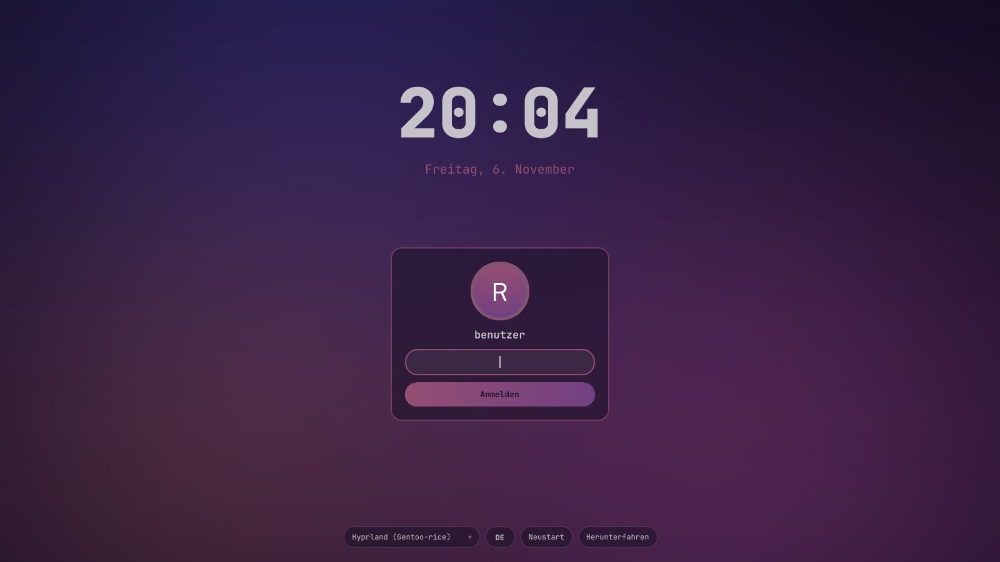
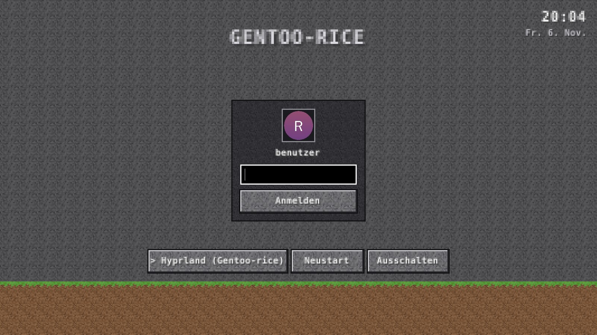

# Gentoo-rice

🇬🇧 **English** · 🇩🇪 [Deutsch](README.de.md)

Wallpaper-driven **anime / lofi** Hyprland rice for **Gentoo (OpenRC)** – every color comes from your current wallpaper.

| Desktop | Wallpaper picker | Terminal toys |
|---|---|---|
|  |  |  |

<!-- Screenshot placeholders: put desktop.png, picker.png, toys.png into screenshots/ -->

## Features

- **Dynamic colors** with pywal16: Hyprland borders, Waybar, kitty, rofi, mako, cava, btop, fastfetch and hyprlock are re-themed on every wallpaper change
- **Theme switcher** (`Super + Shift + T`): lofi (colors from the wallpaper), fsociety, clean, Catppuccin Mocha/Latte, Nord, Gruvbox, Tokyo Night, Sakura – colors, look, wallpaper and GTK colors in one click
- **Hyprland** – translucent windows, strong blur, 10px rounding, thin accent border (gradient), 10px gaps, popin/slide animations
- **Waybar** as three floating islands:
  left media player (prev/play/next + title via playerctl) · center workspace pills (active one wider in accent color) · right CPU, RAM, volume, Wi-Fi, Bluetooth, battery, clock, power
- **Wallpapers:** images via swww/awww with transition, videos via mpvpaper
- **Wallpaper picker** (`Super + W`): horizontal bar at the bottom with cached ffmpeg thumbnails, videos marked with a **VIDEO** badge
- **Wallpaper Engine** live wallpapers from Steam (optional, `./install.sh --we`)
- **Terminal toys** as floating windows: cava, btop, cmatrix, tty-clock, fastfetch (Gentoo logo), lyrics overlay (sptlrx)
- **hyprlock** in the same dynamic colors, shows the current song
- **Login screen** (optional, `--login`): SDDM in the rice look or a blocky style, hyprlock to match
- **Claude Code** installed by default via the official native installer (`Super + K` opens it in a terminal)
- **Firefox**, rofi launcher, mako notifications, Papirus icons
- **Clean cursor:** Bibata via hyprcursor (sharp at any scale), hides while typing and after 5 s idle, flat mouse acceleration, two-finger right click, smoother touchpad scrolling
- **.exe games:** Proton-GE for Steam, ProtonUp-Qt, Bottles (`.exe` opens with a double click)
- **Gaming:** Mesa/RADV for Radeon 780M, Vulkan tools, Flatpak + Flathub, Steam (Flatpak), gamemode, MangoHud (native + Flatpak layer); Steam and games without blur/transparency, games fullscreen with tearing for low latency

## Installation

```sh
git clone https://github.com/Real3rr0r303YT/Gentoo-rice && cd Gentoo-rice && ./install.sh
```

```sh
./install.sh --dry-run   # only show what would be installed/changed (no sudo, no changes)
./install.sh --no-claude # without Claude Code
./install.sh --no-av     # without antivirus
./install.sh --no-apps   # without Spotify/Spicetify, Minecraft, Sober, OBS
./install.sh --no-grub   # leave GRUB untouched
./install.sh --login     # with graphical login screen (SDDM)
```

Run as a normal user – `sudo`/`doas` is only used for system steps.
Every run is logged to `~/.cache/gentoo-rice/install.log`. Before building, emerge does a `--pretend` dry run; required USE/keyword/license changes are written automatically (autounmask + `etc-update --automode -5`). If the batch fails, packages are retried one by one and all failures are listed at the end.
The script can be run repeatedly; unavailable packages are reported and skipped.
Existing configs are backed up to `~/.config-backup/gentoo-rice/<date>/`.

Reboot afterwards and log in on **TTY1** → Hyprland starts automatically.

### Wallpapers

Put images (`jpg png webp gif`) or videos (`mp4 mkv webm mov`) into **`~/Pictures/wallpapers`**.
Only three self-generated gradient placeholders ship with the repo – no third-party images.

```sh
~/.local/share/gentoo-rice/scripts/wallpaper.sh set <file>   # set + regenerate colors
~/.local/share/gentoo-rice/scripts/wallpaper.sh random
~/.local/share/gentoo-rice/scripts/gen-wallpaper.sh 2880x1800 # new gradient placeholder
```

### Steam

`Super + G` opens Steam. Launch options for games: `gamemoderun mangohud %command%`

### Updating

```sh
./scripts/update.sh            # rice: git pull, check links, colors, reload Hyprland/Waybar
                               # installs Hyprland, hyprlock, hypridle + portal if anything is missing
./scripts/update.sh --system   # also Hyprland to the latest version, Gentoo (@world) + Flatpaks
```

### GRUB boot menu

```sh
./scripts/grub-setup.sh               # block theme, menu visible for 5 s, Windows entry via os-prober
./scripts/grub-setup.sh --theme blue  # blue theme (matches the login screen)
./scripts/grub-setup.sh --no-theme    # without a theme
./scripts/grub-setup.sh --timeout 10  # different timeout
./scripts/grub-setup.sh --restore     # restore the original /etc/default/grub
```

Sets `GRUB_TIMEOUT`, `GRUB_TIMEOUT_STYLE=menu` and `GRUB_DISABLE_OS_PROBER=false`, generates the menu in English with short entry names (`Gentoo` – kept after kernel updates via `/etc/kernel/postinst.d/99-gentoo-rice-grub`), backs up `/etc/default/grub` first and regenerates `/boot/grub/grub.cfg`. The default is the block look (dirt, stone buttons, pixel title, Unifont – own textures, no original assets) in `/boot/grub/themes/gentoo-rice-blocks`; `--theme blue` uses the blue theme (blurred wallpaper, JetBrains Mono via `grub-mkfont`). `./install.sh` runs this automatically when GRUB is installed.

### Antivirus (ClamAV)

```bash
./scripts/antivirus.sh setup         # ClamAV + signatures, freshclam/clamd services (./install.sh does this, --no-av)
./scripts/antivirus.sh scan ~/Downloads   # scan a folder
```

- **Real-time watcher** (starts with Hyprland): new files in `~/Downloads` and mods/programs in the Minecraft, CurseForge and Sober folders are scanned immediately; detections are locked away in `~/.local/share/gentoo-rice/quarantine` with a warning
- Minecraft, CurseForge and Sober run **sandboxed** (Flatpak without access to your home folder) – a malicious mod can't reach your files
- Rice menu (`Super + D`): *Virenscan (Home)*, *Quarantäne öffnen*
- **Honestly:** ClamAV only detects known malware. Cracked mods/clients are the most common way stealers and trojans spread – a clean scan is no guarantee. The best protection against ransomware is a backup on a separate drive.

### Apps: Spotify + Spicetify, gaming, OpSec (Proton), OBS Studio

```bash
./scripts/apps.sh             # Spotify + Spicetify, Minecraft Java, CurseForge, Sober (Roblox), Mullvad VPN (GURU), Proton Pass/Mail/Calendar/Authenticator, Tor Browser, Signal, OBS Studio – all Flatpak
./scripts/apps.sh spicetify   # re-apply Spicetify after a Spotify update (update.sh --system does this)
```

Spicetify uses the theme `GentooRice` with the current rice colors (updated on every wallpaper/theme change). `Super + S` opens Spotify; Minecraft, Roblox (Sober) and OBS are in the rice menu (`Super + D`) and the launcher.

### Uninstall

```sh
./uninstall.sh
```

Removes all symlinks (including old wofi/mako/dock links, fastfetch, Firefox profile files), the autostart, the fastfetch entry in `~/.bashrc`, the Firefox policies, the placeholder wallpapers and the thumbnail cache, then restores the backup.

## Wallpaper Engine

Live wallpapers from Steam's **Wallpaper Engine** via [linux-wallpaperengine](https://github.com/Almamu/linux-wallpaperengine) by Almamu.

**Requirements**

- Wallpaper Engine **bought and installed in Steam** (App ID 431960) – the assets and Workshop wallpapers come from there
- Steam as Flatpak (`~/.var/app/com.valvesoftware.Steam/.local/share/Steam`) or native (`~/.local/share/Steam`); extra libraries from `libraryfolders.vdf` are detected automatically

**Install**

```sh
./install.sh --we                 # rice + Wallpaper Engine
./scripts/wallpaperengine.sh      # Wallpaper Engine only (re-run = git pull + rebuild)
```

Installs the build dependencies via emerge, clones the repo with submodules to `~/.local/src/linux-wallpaperengine`, builds it with cmake and installs it to `~/.local/bin`.

**Usage**

- Subscribe to wallpapers in the Steam Workshop → `Super + W` shows them with a **WE** badge and the title from `project.json` (types `scene` and `video`; `web` is marked experimental)
- Directly: `~/.local/share/gentoo-rice/scripts/we-set.sh <workshop-id|folder>` · stop: `we-set.sh stop`
- The rice colors are generated from the wallpaper's `preview.jpg/gif`
- The last wallpaper is restored when Hyprland starts
- Settings in `~/.config/gentoo-rice/wallpaperengine.conf`: FPS (default 30), sound (default `--silent`), automute, scaling, **pause while a window is fullscreen** (default on, via Hyprland socket events), extra arguments
- If linux-wallpaperengine fails to start, the preview image is shown via swww and an error notification appears (log: `~/.cache/rice/linux-wallpaperengine.log`)

**Known limitations**

- Not every scene renders correctly – linux-wallpaperengine does not support all Wallpaper Engine effects
- `web` wallpapers are experimental; `application` wallpapers are not supported
- User properties from the Wallpaper Engine UI are not applied automatically
- Pausing stops the process (SIGSTOP) – the last frame stays visible
- No wallpapers or Workshop content are shipped with this repo

## Login screen (optional)

Graphical login with **SDDM** in Wayland mode (greeter runs in Weston, German keyboard) instead of logging in on TTY1:

```sh
./install.sh --login              # rice + login screen (theme gentoo-rice)
./install.sh --login=minecraft    # blocky look
./scripts/login-screen.sh --theme gentoo-rice   # login screen only
```

| `gentoo-rice` | `gentoo-rice-blocks` |
|---|---|
|  |  |

| Theme | Look |
|---|---|
| `gentoo-rice` | blurred current wallpaper, colors from the palette (pywal16 or active theme), big clock + date, round avatar, glass password field, session picker (Hyprland preselected), reboot/power off |
| `gentoo-rice-blocks` (`--login=minecraft`) | pixel font, stone/dirt textures, blocky buttons – all graphics self-made (`tools/gen-pixel-textures.py`), no third-party textures, logos or fonts |

- **Avatar:** save a picture as `~/.face` (otherwise a placeholder with your initial), then run `scripts/sddm-sync.sh`
- Wallpaper, colors and avatar are copied to `/var/lib/gentoo-rice/sddm/` on every wallpaper/theme change; **hyprlock** uses the same style and avatar
- Session "Hyprland (Gentoo-rice)" starts Hyprland with a dbus session bus (OpenRC)
- The TTY1 autostart is removed so Hyprland does not start twice
- OpenRC: `gui-libs/display-manager-init`, `DISPLAYMANAGER="sddm"` in `/etc/conf.d/display-manager`, `display-manager` in runlevel `default`
- Without Weston, SDDM falls back to X11
- Every changed system file is backed up (`/var/lib/gentoo-rice/backup/`)

**Undo:** `./scripts/login-screen-uninstall.sh` – removes `display-manager` from the runlevel, restores all files and brings back the TTY1 autostart.

### Emergency exit

If the login screen does not start (black screen, crash):

1. Press `Ctrl + Alt + F2` → log in on the text console
2. `sudo rc-update del display-manager default`
3. `sudo reboot` → login on TTY1 again
4. Afterwards: `./scripts/login-screen-uninstall.sh`

Tip: preview a login theme without rebooting: `pip install PySide6-Essentials` and `QT_QPA_PLATFORM=offscreen python3 tools/sddm-preview.py sddm/gentoo-rice preview.png`

## Themes

`Super + Shift + T` (or the palette icon in Waybar) opens a bar with color previews. A theme sets:

- colors for Hyprland borders, Waybar, kitty, rofi, mako, cava, btop, fastfetch, hyprlock and **GTK 3/4 apps** (`~/.config/gtk-*/gtk.css`)
- look: gaps, rounding, transparency, blur
- mouse cursor: Bibata Ice (white), Classic (black) or Amber, matching the theme
- light/dark mode for GTK/libadwaita
- a generated gradient wallpaper in the theme colors

| Theme | Style |
|---|---|
| `lofi` | colors from the current wallpaper (pywal16), default |
| `fsociety` | black/red, sharp corners |
| `clean` | minimal dark, blue accent |
| `catppuccin-mocha` / `catppuccin-latte` | pastel dark / light |
| `nord` | cool blue-grey |
| `gruvbox` | warm retro |
| `tokyo-night` | neon blue/purple |
| `sakura` | cherry-blossom pink |

With a fixed theme, wallpapers chosen via `Super + W` keep the theme colors; switch back to `lofi` to get colors from the wallpaper again.

```sh
~/.local/share/gentoo-rice/scripts/theme.sh list
~/.local/share/gentoo-rice/scripts/theme.sh set nord
```

Your own theme: copy `themes/nord/` to `themes/<name>/` and edit `theme.conf` (palette, look values, `WALLPAPER=gradient|keep`).

## Proton & .exe games

- **Steam games:** Steam (Flatpak) brings Proton. Enable it once: *Steam → Settings → Compatibility → "Enable Steam Play for all other titles"*. **GE-Proton** (Flatpak extension) can be chosen there or per game (*Properties → Compatibility*).
- **ProtonUp-Qt** installs/updates further Proton versions (GE-Proton, Wine-GE).
- **Single .exe games/installers:** double-click the `.exe` → opens with **Bottles** (Gaming bottle recommended). Alternatively in Steam: *Add a Non-Steam Game* and pick Proton.
- Bottles may read your home folder and `/run/media` (external drives).

## Claude Code

`install.sh` installs [Claude Code](https://claude.ai/code) with the official native installer (`curl -fsSL https://claude.ai/install.sh | bash`), adds `~/.local/bin` to `PATH` in `~/.bashrc` and checks `claude --version`. Claude Code updates itself afterwards.

```sh
claude                              # start in the current folder (first start: log in via browser)
./scripts/install-claude-code.sh    # install/check Claude Code only
```

`Super + K` opens Claude Code in a new terminal. The full developer setup (`--dev`) adds VS Code with the Claude Code extension.

## Firefox

- Installs `www-client/firefox-bin` (no compiling) and sets it as default browser (`xdg-mime`/`xdg-settings` for http, https, HTML)
- `firefox/user.js` + `firefox/userChrome.css` are linked into the default profile (created headless if missing)
- `firefox/policies.json` → `/etc/firefox/policies/` and `/opt/firefox/distribution/`: telemetry off, strict tracking protection, uBlock Origin installed automatically
- `Super + B` opens Firefox (always opaque)

## Dev setup

Optional developer setup – together with the rice or standalone:

```sh
./install.sh --dev          # rice + dev setup
./scripts/dev-setup.sh      # dev setup only
```

| Area | Content |
|---|---|
| Editor | VS Code (`app-editors/vscode`, license accepted), Neovim |
| AI | Claude Code via the official native installer, PATH in `~/.bashrc` |
| Extensions | Claude Code, Python, Pylance, GitLens, Error Lens, GitHub Theme |
| VS Code look | JetBrains Mono + ligatures, rice colors, custom title bar, smooth scrolling, Wayland (`~/.config/code-flags.conf`) |
| Python | `dev-lang/python`, pip, pipx (`pipx ensurepath`), venv |
| Tools | git, GitHub CLI, Node.js + npm, gcc, clang, cmake, make, ripgrep, fd, jq, htop, btop, curl, wget |
| Git | asks for name/email if not set |

Re-runnable; unavailable packages are reported and skipped.
An existing `settings.json` is backed up before replacing (`settings.json.bak-<date>`).
A summary of installed versions is printed at the end.

## Keybinds

| Key | Action |
|---|---|
| `Super + Enter` | Terminal (kitty) |
| `Super + Space` | Launcher (rofi) |
| `Super + W` | Wallpaper picker (images, videos, Wallpaper Engine) |
| `Super + Shift + W` | Random wallpaper |
| `Super + D` | Rice menu (apps, Spotify, Minecraft, Roblox, OBS, theme, wallpaper, login screen, update, keybindings) |
| `Super + Shift + T` | Theme switcher |
| `Super + B` | Firefox |
| `Super + G` | Steam |
| `Super + S` | Spotify |
| `Super + Shift + G` | Gaming mode on/off (no animations/blur/shadows/gaps, wallpaper paused; also via Waybar icon) |
| `Super + E` | File manager |
| `Super + A` | cava (audio visualizer) |
| `Super + T` | btop |
| `Super + M` | cmatrix |
| `Super + C` | tty-clock |
| `Super + I` | fastfetch |
| `Super + Y` | Lyrics overlay (toggle) |
| `Super + K` | Claude Code (terminal) |
| `Super + Q` | Close window |
| `Super + F` | Firefox |
| `Super + Shift + F` | Fullscreen |
| `Super + V` | Toggle floating |
| `Super + P` | Pseudo tiling |
| `Super + J` | Toggle split |
| `Super + L` | Lock screen |
| `Super + Shift + E` | Power menu |
| `Super + Shift + R` | Reload Hyprland |
| `Super + 1–6` | Switch workspace |
| `Super + Shift + 1–6` | Move window to workspace |
| `Super + Arrow keys` | Move focus |
| `Super + Shift + Arrow keys` | Move window |
| `Super + Mouse wheel` | Switch workspace |
| `Super + LMB / RMB` | Move / resize window |
| `Print` / `Shift + Print` | Screenshot area / screen |
| Media keys | Volume, brightness, play/pause, next/previous |
| 3-finger swipe | Switch workspace (Hyprland ≥ 0.53) |

## Structure

```
hypr/        hyprland.lua (Lua config, new Hyprland e.g. 0.57), hyprland.conf + compat/ (older hyprlang versions),
             hyprlock.conf, hypridle.conf
waybar/      config.jsonc, style.css (colors.css → generated)
kitty/       kitty.conf (colors-wal.conf → generated)
rofi/        config.rasi (launcher), wallpaper.rasi (picker), menu.rasi
wal/         templates/ for pywal16 (Hyprland, Waybar, rofi, mako, cava)
themes/      theme presets (theme.conf)
fastfetch/   config.jsonc
firefox/     user.js, userChrome.css, policies.json
gtk/         gtk-3.0 / gtk-4.0 settings.ini
sddm/        login themes gentoo-rice and gentoo-rice-blocks (QML)
vscode/      settings.json, code-flags.conf
wallpapers/  3 generated gradient placeholders
config/      wallpaperengine.conf (template)
scripts/     wallpaper.sh, theme.sh, login-screen.sh, sddm-sync.sh, we-set.sh, install-claude-code.sh, …
tools/       sddm-preview.py, gen-pixel-textures.py
.github/     CI: ShellCheck, JSON, Lua, qmllint + render test of the SDDM themes
```

## Support

☕ [Buy me a coffee](https://buymeacoffee.com/3rr0r303YT)

## License

Copyright © 2026 3rr0r303YT

This project is licensed under the **GNU General Public License v3.0** – see [LICENSE](LICENSE).
You may use, modify and redistribute it as long as derivative works are also licensed under GPL-3.0.
Bibata cursors and sptlrx are downloaded from their original releases at install time and are subject to their own licenses.
